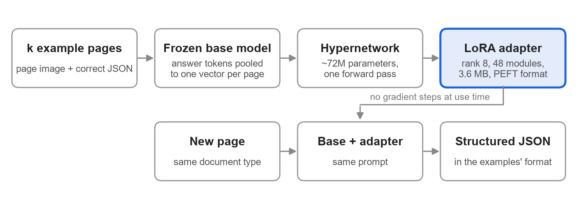
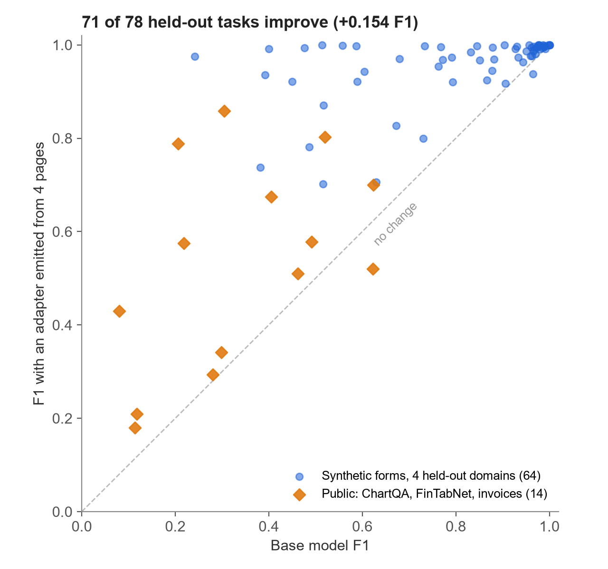

I built a small hypernetwork that reads four example pages of a new document type and outputs a LoRA adapter for MiniCPM-V in one forward pass, with nothing trained at use time. Across 78 document tasks the network never saw during training, those adapters raised field-level F1 from **0.728 to 0.881** and helped on **71 of the 78** tasks. This post explains how the system works, the checks I ran before building each piece, what the results do and don't show yet, and where to find the code and weights.

Small vision-language models now run on a laptop or a phone, yet they constantly meet document layouts they have never seen: a new invoice template, a lab's report format, a shipping label. The usual fix is to fine-tune an adapter for each layout. That requires a GPU, a training loop, and someone who knows how to run it.

I wanted something closer to teaching a person: show the model a few pages with the right answers and let it pick up the pattern. That is the idea behind **Show-to-LoRA**, which reads a handful of example pages and writes a LoRA adapter for the frozen model in a single forward pass. I built it on [MiniCPM-V-4.7-1B](https://huggingface.co/openbmb/MiniCPM-V-4.7-1B) as an entry in OpenBMB's MiniCPM Spark Program (On-Device Agent Challenge). A [companion post](/blog/show-to-lora-blood-counts/) applies it to a real-world case: reading blood test reports.

## Prompts, skills and LoRA adapters

There are three common ways to get a model to do a new job. They work at different levels, so I find it helpful to look at them side by side.

| | Prompting (including few-shot) | Skills and plugins | LoRA adapters |
| --- | --- | --- | --- |
| What it changes | the text the model reads | the instructions, files and tools the model can load or call | the model's weights, through a small add-on |
| Best for | stating the task, the format and the rules | reaching outside the model: APIs, code, search, saved procedures | abilities the model lacks even when told exactly what to do: a layout, a style, a domain's conventions |
| Cost per request | the prompt is paid for every time, and long few-shot prompts add up | small until loaded, then the skill's text and any tool calls | no extra input; the add-on is a few MB and can be merged into the weights |
| Setup | write text | write instructions or code, inside an agent that supports them | usually a training run, with labelled data and a GPU |
| Limits | context length, and how well the model follows long instructions (often weak in small models) | can't make the model see or read better than it already does | needs access to the weights; one adapter per job; can hurt outside its domain |
| Switching | instant | instant | load a different adapter file |

These approaches stack rather than compete. A prompt tells the model what you want, and a skill gives it tools and procedures. An adapter changes how well the model does the work itself. I start with a prompt, then add skills when the job needs something outside the model. If the model keeps failing at something it has been clearly told to do, I use an adapter.

The catch with adapters has always been the training run. Show-to-LoRA gets rid of it. You pass in a few labelled examples and get an adapter out in one forward pass.

## How it works

*From k example pages to a PEFT adapter. The base model's weights stay frozen; the adapter is a separate 3.6 MB file.*

1. **Encode the examples.** The frozen base model reads each example page along with its correct JSON answer. I average its final hidden states over the answer tokens to get one vector per example.
2. **Write the adapter.** A hypernetwork of roughly 72M parameters averages those vectors and outputs rank-8 LoRA weights for 48 modules of the language model.
3. **Use it.** The adapter saves in the standard PEFT format, so transformers, vLLM, or llama.cpp (after conversion) can load it just like any ordinary LoRA.

The setup follows Sakana AI's [Text-to-LoRA](https://github.com/SakanaAI/text-to-lora), which generates adapters from a text description of a task. Here the description is a few labelled page images instead. For document layouts, handing over a few pages is often much easier for a user than writing an exact specification.

## Under the hood

**The adapter.** LoRA leaves each frozen weight matrix $$W$$ untouched and adds a small low-rank correction beside it:

$$
h = W x + \frac{\alpha}{r}\, B A x
$$

Here $$A$$ and $$B$$ are thin matrices of rank $$r = 8$$, and $$\alpha = 16$$. There are 48 adapted modules in the language model: the $$q$$ and $$v$$ projections in the 6 full-attention layers, plus the input and output projections in the 18 linear-attention layers. The hypernetwork's entire job is to produce every $$A$$ and $$B$$.

**From examples to one vector.** For each example page, the frozen model reads the page, the prompt, and the correct JSON. I average its last-layer hidden states over the answer tokens only, giving a vector $$e_i$$ of 1,024 numbers, and then average those across the $$k$$ examples:

$$
z = \frac{1}{k} \sum_{i=1}^{k} e_i
$$

Pooling only the answer tokens focuses the vector on what the right output looks like for that kind of page. On the development tasks this scored 0.978 F1, compared to 0.975 when I pooled the page tokens as well.

**From the vector to weights.** A small 3-layer MLP (width 512) runs once per module. It takes the task vector plus two learned tags indicating which layer and which kind of projection it is writing for, and linear output heads turn its output into that module's $$A$$ and $$B$$. Most of the 72M parameters live in those heads. A learned shared adapter sits on top to cover whatever all document tasks have in common. The hypernetwork output starts at zero, so at the beginning of training the adapter changes nothing, just like a fresh LoRA.

**Training.** Each step picks 8 tasks. For each one, the hypernetwork sees $$k \in \{1, 2, 4, 8\}$$ support pages, writes an adapter, and gets scored on a different page $$(x, y)$$ from the same task using the usual next-token loss:

$$
\mathcal{L}(\theta) = -\sum_{t} \log p_{\,W + \Delta W_\theta(z)}\big(y_t \mid x,\ y_{<t}\big)
$$

Only the hypernetwork's weights $$\theta$$ are updated. Gradients flow back through the frozen model into the hypernetwork, pushing it to write adapters that hold up on pages it did not see. The final run used AdamW at a learning rate of $$10^{-4}$$ with a cosine schedule for 6,000 steps, covering 48,000 query pages across 333 training tasks.

**Scoring.** I flatten every prediction and label into (field, value) pairs, ignoring row order, and compute F1 over those pairs across all pages of a task. Any output that is not valid JSON counts as an empty prediction.

## Step 1: checking whether an adapter has room to help

A hypernetwork can only write adapters as good as ordinary ones. Before building it, I tested whether a standard LoRA trained directly on each task beats the base model on 20 receipt and form tasks (CORD, SROIE, WildReceipt, FUNSD, and XFUND). It had to beat both the plain model and the model given 1 or 4 examples in the prompt.

Three things came out of that check:

- **There is real headroom.** Ordinary LoRAs gained +0.1 to +0.4 F1 on most of the receipt tasks.
- **In-prompt examples barely help small models, and often hurt.** On one model, putting four examples in the prompt dropped SROIE scores by 0.3 to 0.5. Simply showing examples in the prompt is a weak option at this size, which is the gap an adapter fills.
- **Which layers you adapt matters.** MiniCPM-V 4.7 has a hybrid language model: only 6 of its 24 layers have standard attention projections, while the other 18 use linear attention. Adapting only the standard q and v projections reaches a quarter of the model. Adding the linear-attention projections did better on both models I tested (14 wins against 7 on one, and a higher mean gain on the other), so every adapter in this project targets both.

I also exported one adapter to llama.cpp, the runtime most on-device apps use. Across 150 documents, it scored within 0.03 F1 of the PyTorch run, provided the base model's GGUF is converted without fusing the projection weights.

## Step 2: picking the base model honestly

The first check pointed to MiniCPM-OCR-1.0 as the model with the most headroom. A follow-up showed why: I had run it at a lower image resolution than its default. At its default resolution its baseline climbed, and the LoRA beat it on only 7 of 20 tasks. MiniCPM-V-4.7-1B with a LoRA, running at its own defaults, matched or beat OCR's best baseline on 18 of 20. I switched to V-4.7.

## Step 3: building a pool of tasks

To learn how examples map to adapters, the hypernetwork needs a broad set of tasks. I built **443 tasks**:

| | Training | Held out for testing |
| --- | ---: | ---: |
| Synthetic forms in English and Chinese | 320 | 64 |
| Receipts, forms, tables, charts, formulas (public datasets) | 45 | 10 |
| Invoices (public dataset) | 0 | 4 |
| **Total** | **365** | **78** |

- **Whole datasets and whole domains are held out**, not random pages. The test set consists of FinTabNet, ChartQA, an invoice dataset, and every template from four synthetic domains: payslips, purchase orders, restaurant bills, and shipping labels. The network never saw any of them, or anything from those domains.
- **Every label is real.** Public tasks use the datasets' own annotations, and synthetic forms use the exact strings the renderer printed. No label anywhere comes from another model.
- **Duplicates were checked across splits.** That check caught receipts from the same store sitting in both the training and evaluation splits of SROIE, which had slightly inflated my first headroom numbers. I removed those pages, and no duplicate crossed into the held-out set.

## Step 4: training the hypernetwork

Training runs end to end. The hypernetwork writes an adapter from 4 support pages, the frozen model uses that adapter to answer a different page of the same task, and the loss on that answer trains the hypernetwork. The final run learned from 333 of the 365 training tasks, took 6,000 steps (about five hours on one A10G GPU), and brought the training loss down from 0.171 to 0.033. I used the other 32 training tasks as a development set to choose the learning rate and embedding recipe before touching the test set. On those 32 tasks, the base model scored 0.873 and the emitted adapters reached 0.978.

## Results on 78 held-out tasks

*Each point is one held-out task: base model F1 on the x axis, F1 with an adapter emitted from 4 pages on the y axis. Points above the dashed line improved.*

| Held-out tasks | Base model | Emitted adapter (4 pages) | Gain [95% CI] | Better / worse |
| --- | ---: | ---: | --- | ---: |
| All (78) | 0.728 | 0.881 | +0.154 [+0.116, +0.195] | 71 / 2 |
| Synthetic forms (64) | 0.813 | 0.957 | +0.145 | 58 / 1 |
| Charts, financial tables, invoices (14) | 0.339 | 0.533 | +0.194 | 13 / 1 |

Both columns use the same pages, the same greedy decoding, and the same GPU. "Better" and "worse" mean a change of more than 0.005 F1 on the task.

The largest gains show up where the base model is weakest. A Chinese purchase-order form went from 0.24 to 0.98, and one FinTabNet table task rose from 0.21 to 0.79. On English synthetic forms the base model is already near 0.95, so there is little room left to add. Charts are the weakest area, with gains between +0.01 and +0.27. Two tasks got worse: an invoice-parties task (0.62 to 0.52) and one Chinese restaurant bill (0.97 to 0.94).

## What these results don't show yet

I only compared against the plain base model. To save time and budget, I did not run these on the held-out tasks:

- the same 4 examples placed in the prompt instead of turned into an adapter;
- one multi-task LoRA trained on all 365 training tasks;
- a LoRA trained directly on each held-out task, as an upper bound.

The multi-task LoRA matters most. In an earlier pilot on the 20 receipt and form tasks, a single LoRA trained across all of them beat the per-task LoRAs. So I can say the emitted adapters clearly beat the base model on unseen document types, but not yet that they beat one well-trained general adapter. That multi-task adapter is already trained, so running that comparison is next.

## Code and weights

- **Library:** [openT2L on GitHub](https://github.com/ASH1998/openT2L). The core depends only on `torch` and `safetensors` and works with any PyTorch model whose adapted layers are `nn.Linear`. You give it module-name patterns, it reads the shapes from the model, and adapters come out in PEFT format.
- **Hypernetwork weights:** [ASHu2/openT2L-MiniCPM-V-4.7-1B-docs](https://huggingface.co/ASHu2/openT2L-MiniCPM-V-4.7-1B-docs) on Hugging Face. I ran the model card's code as published on three held-out tasks, and it reproduced the evaluation outputs exactly on two of them.
- **Experiment code, protocols and every result:** [openBMB-spark-t2l](https://github.com/ASH1998/openBMB-spark-t2l). Each stage has a protocol written before its runs, and failed and negative runs are logged too.

The hypernetwork weights are released for **non-commercial use** (CC BY-NC 4.0) because some of the training datasets are non-commercial. The code is Apache-2.0.

From the first headroom check to the final evaluation, the whole project used about USD 170 of cloud GPU time by my own ledger.

## What's next

The point of all this is an on-device agent. It hits a document it reads badly, the user corrects a few pages, and it installs a new 3.6 MB skill in seconds, keeping a local library of them. The [next post](/blog/show-to-lora-blood-counts/) walks through that loop on real blood test reports, including the parts that still don't work.
