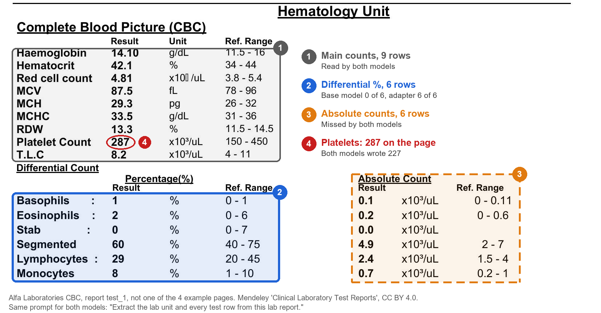
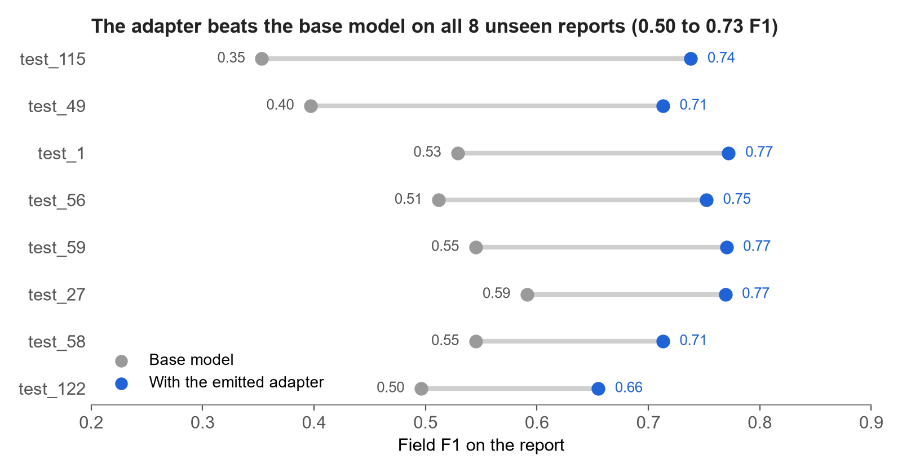
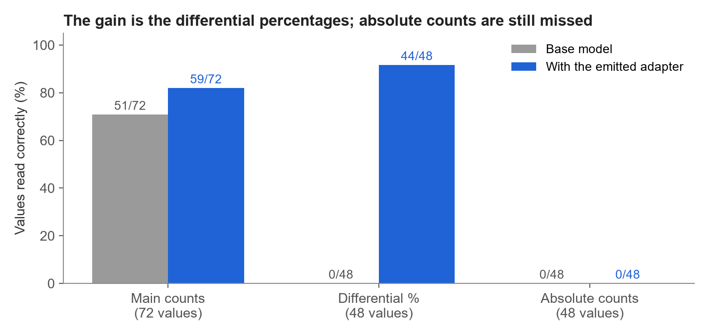

Small vision-language models that run on a laptop or phone can miss important parts of a real document, and on-device you don't have a server to fine-tune them. In this post I test whether four corrected blood test reports are enough to fix one of those failures in OpenBMB's MiniCPM-V-4.7-1B using a single forward pass of a LoRA hypernetwork. You'll see how I found the failure, how the generated adapter did on unseen reports, and every way it still falls short.

In the [previous post](/blog/show-to-lora/) I wrote about Show-to-LoRA, a small network that reads a few example pages of a new document type and outputs a LoRA adapter for a frozen vision-language model in one forward pass. Averaged over 78 held-out tasks, the method works. Averages on synthetic forms and public benchmarks only tell you so much, though. They don't show whether it helps on a real document someone actually needs read.

I wanted one concrete case where the base model clearly fails, so I could check whether four corrected pages would fix it. Blood test reports gave me that case.

The model is [MiniCPM-V-4.7-1B](https://huggingface.co/openbmb/MiniCPM-V-4.7-1B) from [OpenBMB](https://github.com/OpenBMB), a vision-language model small enough to run on a laptop or phone. This work is part of my entry to OpenBMB's MiniCPM Spark Program (On-Device Agent Challenge). Running on-device is where a cheap, per-document skill actually matters, because there is no server to fine-tune on.

**The short version:** on complete blood count (CBC) reports from one lab, MiniCPM-V-4.7-1B reads the first nine rows and stops, skipping the whole differential count. An adapter built from 4 corrected reports in 34 seconds got the same model reading the differential percentages. It beat the base model on **all 8** unseen reports, pushing field F1 from **0.50 to 0.73**. It still misses the absolute counts, and I'll walk through every place it goes wrong below.

## The data

The reports come from the public [Clinical Laboratory Test Reports](https://doi.org/10.17632/bygfmk4rx9.2) dataset on Mendeley Data (CC BY 4.0). It holds 260 real scanned and printed reports from 24 laboratories in Egypt, written in English with Arabic headers. Because the dataset has no structured labels, I made them myself.

## Finding where the model fails

My first attempt was on Alfa Laboratories' chemistry and hormone panels, and it turned up nothing. Those pages have clean printed rows, so the base model already scored 0.97 F1. There wasn't room for an adapter to help, and on 6 test pages it didn't (0.965).

That negative result was still useful. A skill only helps where the base model is wrong, so I needed to find a real failure first. I ran the base model alone on 3 pages from each of 7 lab layouts and checked every output against its page by eye.

| Layout | What the base model did |
| --- | --- |
| Blood counts at Alfa, Al Mokhtabar, Omega and Grand | Read the first ~9 rows, then stopped. The differential count was dropped on every page |
| Green Lab blood count | Returned no rows at all |
| Mabaret El Asafra (mostly blank forms) | Put reference ranges in the result column |
| Single tests (ferritin, CRP), lipids, urine | Mostly right |


Every lab that prints a blood count triggered the same failure, and it hits a part of the report that matters. The differential count splits white blood cells into six types, which a doctor reads to tell, for example, a bacterial infection from a viral one.

## The test

I went with Alfa Laboratories blood counts, the most common layout in the dataset. Four reports appear more than once in the dataset, so I removed the duplicates before splitting, leaving 17 distinct reports.

- **4 reports taught the skill.** Each came with its correct JSON, the "corrections" a user would supply.
- **8 other reports were only scored.** The hypernetwork never saw them, and it had never seen any lab report during training either.
- **Each label has 21 rows:** 9 main counts, 6 differential percentages, and 6 absolute counts, each with its unit and reference range. I drafted the labels from the images, and a person checked every page against the original.

Both models ran with the same plain prompt, greedy decoding, and the same A10G GPU:

```
Extract the lab unit and every test row from this lab report.
Return only JSON with this shape: {"unit": str, "tests": [{"name": str, "result": str, "unit": str, "range": str}]}
Copy text exactly as printed. Use an empty string or empty list when a field is absent.
```

Nothing in the prompt tells the model that differential rows count as test rows. It only learns that from the four examples.

## What changed on the page



*One of the 8 test reports. (1) The nine main counts: both models read them. (2) The differential percentages: the base model returned none, while the adapter returned all six correctly. (3) The absolute counts: neither model returned them under the cells' names. (4) Both models read the platelet count of 287 as 227.*

Here is the end of each model's output for that report:

```
Base model (stops here)            With the emitted adapter
-----------------------            ------------------------
T-LC          8.2   x10^9/uL       T-LC          8.2   x10^9/uL
                                   Basophils     1     %   0 - 1
                                   Eosinophils   2     %   0 - 6
                                   Stab          0     %   0 - 7
                                   Segmented     60    %   40 - 75
                                   Lymphocytes   29    %   20 - 45
                                   Monocytes     8     %   1 - 10
```

## Results



*Field F1 per unseen report. Grey: base model. Blue: with the adapter written from 4 example reports.*

| | Base model | With the adapter |
| --- | ---: | ---: |
| Field F1 (8 reports) | 0.496 | **0.733** |
| Recall | 0.356 | 0.701 |
| Precision | 0.817 | 0.769 |
| Reports better | | 8 of 8 |


F1 is computed over (field, value) pairs after Unicode and whitespace normalisation, ignoring row order.



*Where the gain comes from. Almost all of it is the differential percentages, going from 0 of 48 to 44 of 48.*

Building the skill took **34 seconds** on the GPU and produced a **3.6 MB** file. Because the base model weights stay untouched, a device can keep a library of these skills and load the right one for each document. Generation does take longer with the adapter, about 20 to 30 seconds per report on an A10G compared to about 15 for the base model, because the model is now writing out the rows it used to skip.

## What still doesn't work

I didn't expect a 1B model on a phone to read every report perfectly, and this skill doesn't either. Here is where it still falls short:

- **Absolute counts are still missed.** The skill reads that column group, but it labels the rows "Absolute Count" instead of naming the cell. Those 48 values don't count.
- **A heading sometimes turns into a row.** On 2 of the 8 reports, that shifts the percentages down by one row. That's also why precision lands slightly below the base model's (0.77 vs. 0.82).
- **The output shape matters.** When I asked for a separate `differential` section, results got worse (0.51 vs. 0.85). The hypernetwork only learned flat lists.
- **The test set is small:** 8 reports from one lab.

This isn't a medical tool, so check every value against the original report.

## Try it

The adapter is on Hugging Face at [ASHu2/openT2L-skill-alfa-cbc](https://huggingface.co/ASHu2/openT2L-skill-alfa-cbc). It's a standard PEFT LoRA, with the exact prompt and the names of the 4 example reports saved in `skill.json`. It was generated by the [openT2L hypernetwork](https://huggingface.co/ASHu2/openT2L-MiniCPM-V-4.7-1B-docs) and carries the same non-commercial license (CC BY-NC 4.0) as the hypernetwork. I'm not redistributing the report images, since they're available in the Mendeley dataset linked above.

I'll add the agent code (learning a skill, keeping it in a local library, and switching adapters per document) along with the script behind every number in this post to [openBMB-spark-t2l](https://github.com/ASH1998/openBMB-spark-t2l) with the rest of the project.

The failures make the next steps pretty clear. First, I need to teach the hypernetwork to produce outputs with more than one section, so a schema like `tests` plus `differential` works. Second, I want to run the whole loop on a laptop with llama.cpp instead of a cloud GPU.
